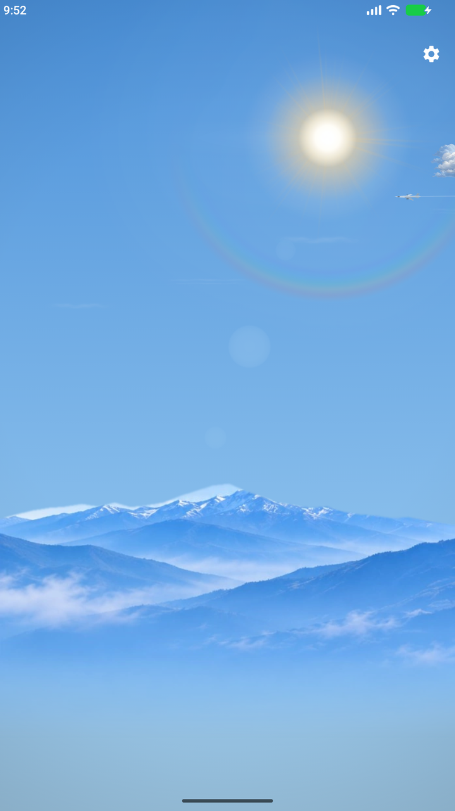
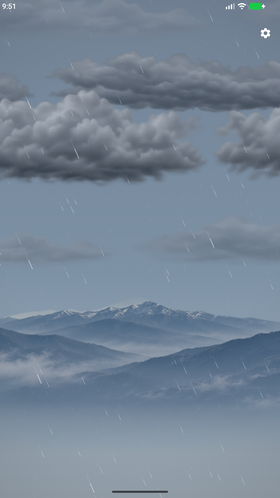
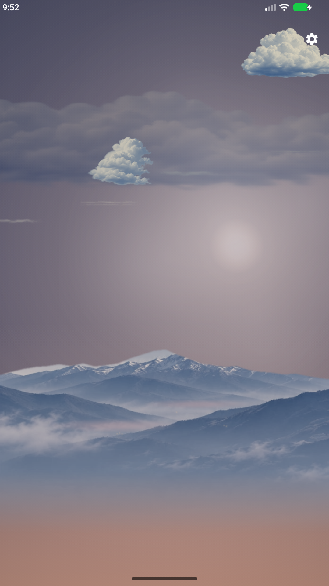
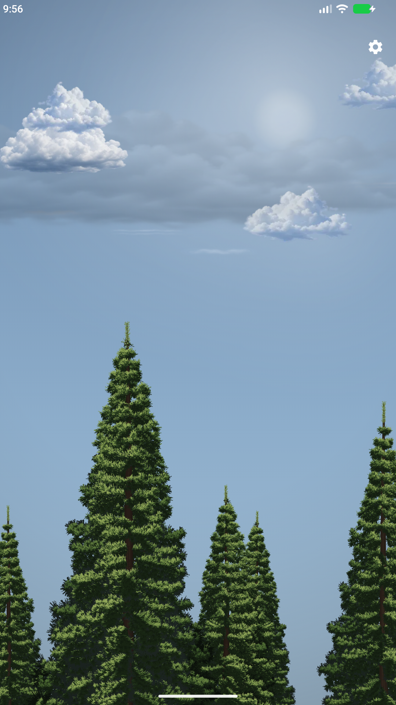

# Weatherd

[](https://github.com/Attacktive/weatherd/actions/workflows/test.yaml)

Android live wallpaper that turns real weather into an animated procedural scene, with a matching in-app preview.

[Get Weatherd on Google Play](https://play.google.com/store/apps/details?id=xyz.attacktive.weatherd)

Requires **Android 8.0 (API 26)** or later.

## Screenshots

These are actual Weatherd **3.9.20** preview captures using simulated weather and time of day, with the simulator controls hidden. The preview and live wallpaper share the same scene renderer. Select a screenshot to see it at full resolution.

| Clear sky | Rain | Dusk | Clouds & trees |
| --- | --- | --- | --- |
| [](store/screenshot-phone-1080x1920.png) | [](store/screenshot-phone-rain-1080x1920.png) | [](store/screenshot-phone-dusk-1080x1920.png) | [](store/screenshot-phone-clouds-1080x1920.png) |

**Tablet screenshots:** [Clear sky](store/screenshot-tablet-clear.png) · [Rain](store/screenshot-tablet-rain.png) · [Dusk](store/screenshot-tablet-dusk.png) · [Clouds & trees](store/screenshot-tablet-clouds.png).

[See all screenshot assets and capture notes](store/README.md).

## Features

- Live weather from device location or a manually searched city, with selectable providers and a global fallback for regional models.
- Weather-driven clouds, precipitation, fog, humidity haze, lightning, and day/night lighting.
- Customizable sky palettes, sun styles, lunar phases, birds, and distant aircraft.
- Optional Halloween, Christmas, and New Year's night-sky celebrations, with a setting to turn them off.
- Scenery, personal photo backgrounds, and optional Evergreen or Broadleaf trees with Spring, Summer, Autumn, Winter, or location-aware Auto foliage.
- Appearance presets, weather/location labels, and readability shading behind launcher icons.
- A scene simulator that changes both the preview and live wallpaper without replacing cached real weather.
- A home-screen weather refresh widget and configurable motion/performance controls.

**Settings** groups controls into Appearance, Weather, Wallpaper, and Advanced; the app interface follows Android's system light/dark appearance independently of the scene.

## Weather refresh

Weatherd checks when the preview resumes, the wallpaper becomes visible, or relevant location/provider settings change.
The refresh interval (**15 minutes–6 hours**) is a minimum between automatic fetches, not a background timer.
**Refresh now** and the refresh widget bypass it; offline widget requests wait for a network connection.
Check **Settings → Weather → Last updated** for the last successful refresh.

## Building from source

Requires JDK 21 and the Android SDK ([Android Studio](https://developer.android.com/studio) bundles both).

```sh
git clone https://github.com/Attacktive/weatherd.git
cd weatherd
./gradlew assembleDebug
```

Debug builds need no secrets or weather API keys.
Release signing requires `release.keystore` and `KEYSTORE_PASSWORD`.

Run unit tests, lint, and Detekt with:

```sh
./gradlew test :app:lint :app:detekt
```

**Instrumentation warning:** `connectedDebugAndroidTest` currently removes Weatherd and its app data during teardown; use only a disposable device or emulator.
See [AGENTS.md](AGENTS.md) for core architectural constraints and the [development reference](docs/development.md) for in-place instrumentation, asset generators, provider evaluation, and monitoring setup.

## Weather data attribution

Forecasts are available from [Open-Meteo](https://open-meteo.com) Best Match, [MET Norway](https://api.met.no), and these ICON models through Open-Meteo:

- DWD ICON Global (~11 km), ICON EU (~7 km), and ICON D2 (~2 km)
- [ItaliaMeteo ICON-2I](https://open-meteo.com/en/docs/italia-meteo-arpae-api) (~2 km)
- [MeteoSwiss ICON CH1 and CH2](https://open-meteo.com/en/docs/meteoswiss-api) (~1 km and ~2 km)

Regional models use the configured global fallback outside their coverage or when a request fails.
Open-Meteo and The Norwegian Meteorological Institute ("MET Norway") provide data under [CC BY 4.0](https://creativecommons.org/licenses/by/4.0/).
Weatherd normalizes provider-specific fields into its weather-condition model and renders them as procedural scenes.

## Artwork credits

- Lunar surface: [NASA SVS CGI Moon Kit](https://svs.gsfc.nasa.gov/4720/), NASA's Scientific Visualization Studio ([public domain unless otherwise noted](https://svs.gsfc.nasa.gov/help/)).
- Radiant sun: [image contributed by @emanuelelina2014-arch](https://github.com/Attacktive/weatherd/issues/255), bundled unchanged with a softened rendering texture prepared at runtime.
- Tree, cloud, Starburst sun, and sun-glare generators produce first-party artwork without sampling reference-app or third-party artwork; the Moon generator uses the credited NASA source above.

## Sister project

[Wallhavend](https://github.com/Attacktive/Wallhavend-android) rotates real photo wallpapers from [Wallhaven](https://wallhaven.cc) on a schedule — same bones, opposite art department.
[Get it on Google Play](https://play.google.com/store/apps/details?id=xyz.attacktive.wallhavend).
